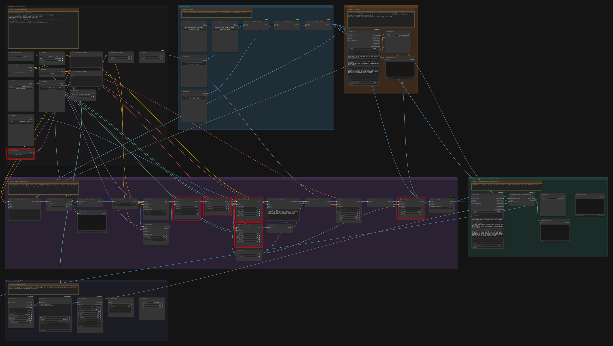
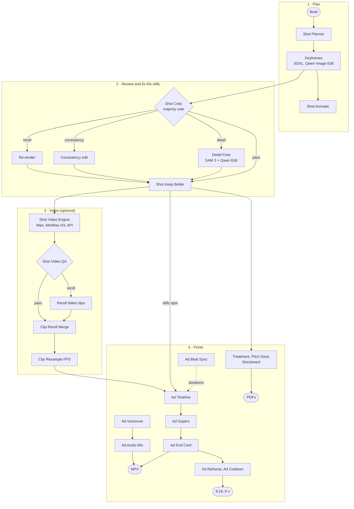
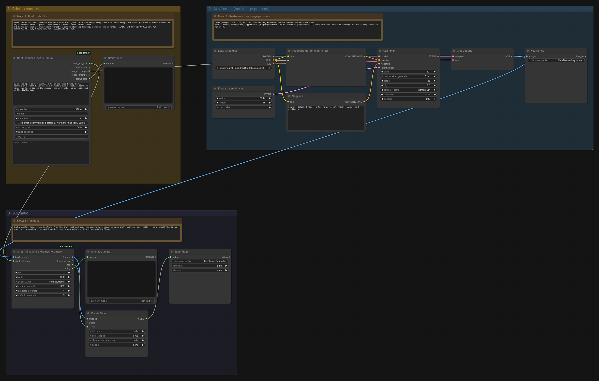
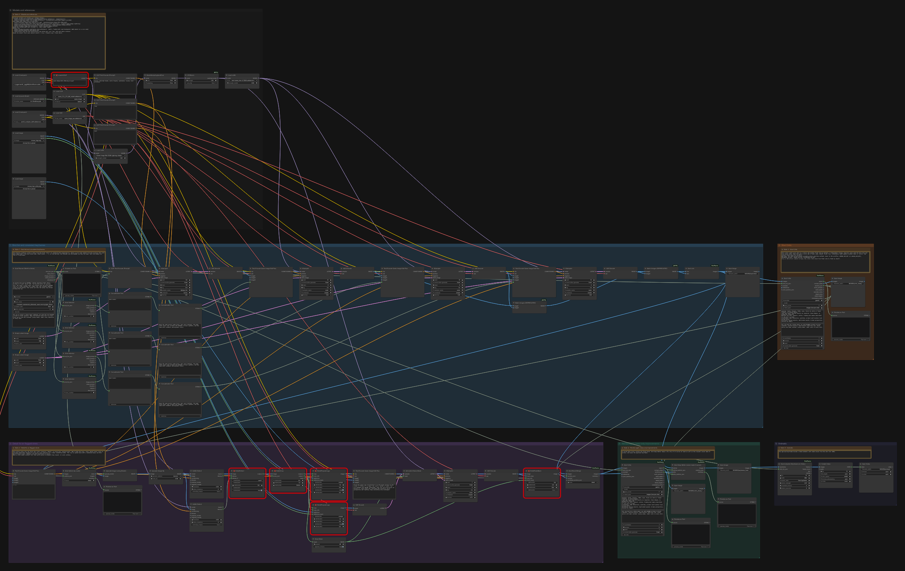
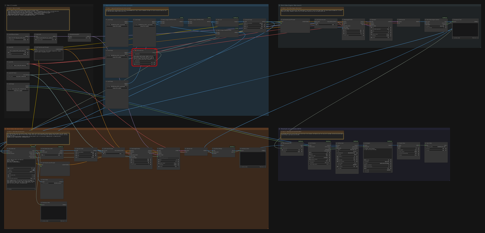
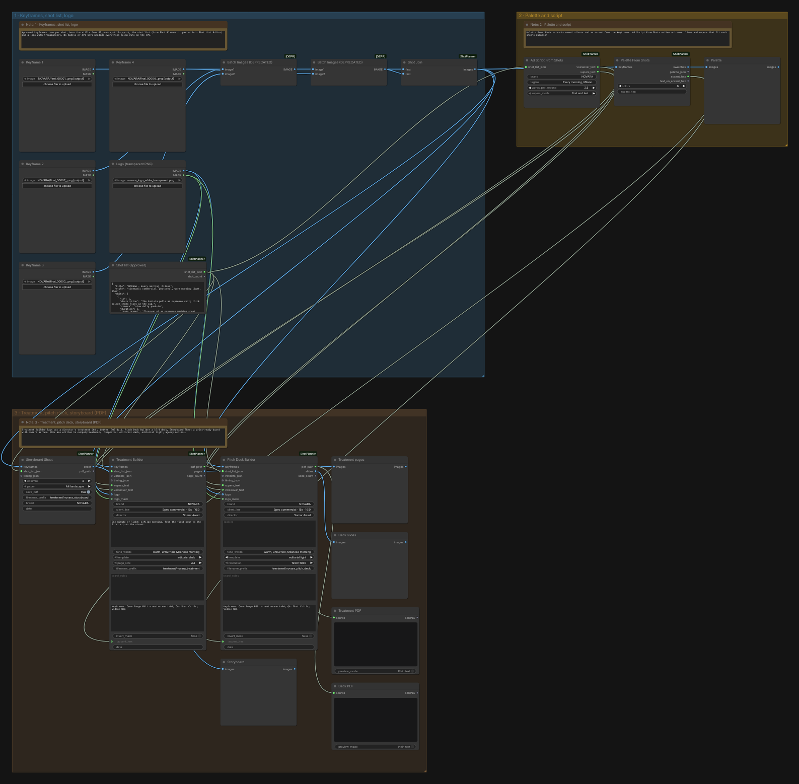

# Shot Planner for ComfyUI

[](https://github.com/Somarawad/ComfyUI-ShotPlanner/actions/workflows/tests.yml)


**From a one-paragraph brief to a finished commercial, inside one ComfyUI graph.** Shot Planner writes
the shot list and the prompts (Claude, GPT, Gemini or offline), turns keyframes into a timed
animatic, and has a vision LLM review every shot like an art director. It then routes each problem
to the cheapest fix (a local logo repair, a consistency edit or a re-render) and keeps a fix only if
it is better. Approved stills go through an image-to-video engine of your choice, where every clip
is checked and only the failures are rerolled. Ad Timeline, supers, end card, voiceover, beat-synced
music and social cutdowns then make the MP4. The same material becomes a director's treatment, a
pitch deck and a storyboard as print-ready PDFs. Built on an RTX 3080 (10 GB) for the NOVARA spec ad
in the examples.



## Pipeline



Every fix branch is **lazy**: when no shot needs it, it does not run at all.

## Install

**ComfyUI-Manager:** search for *Shot Planner* (once it is on the Comfy Registry), or use
*Install via Git URL* with `https://github.com/Somarawad/ComfyUI-ShotPlanner`.

**git:**

```bash
cd ComfyUI/custom_nodes
git clone https://github.com/Somarawad/ComfyUI-ShotPlanner
```

Restart ComfyUI. There are no extra Python packages: the pack uses only what ComfyUI already
installs (torch, numpy, Pillow), and LLM calls go through the standard library.

## Quick start

1. Drag [`examples/workflows/01_brief_to_animatic.json`](examples/workflows/01_brief_to_animatic.json)
   onto the canvas.
2. Put any SDXL checkpoint in `models/checkpoints` and pick it in *Load Checkpoint* (the example uses
   Juggernaut XL).
3. Write your brief in **Shot Planner**. `provider = offline` needs no key; switch to `gemini`,
   `anthropic` or `openai` for LLM-written shots (see [API keys](#api-keys)).
4. Queue. You get one keyframe per shot, a storyboard and an MP4 animatic in `output/ShotPlanner/`.

No GPU at all? [`examples/01_shot_planner_storyboard.json`](examples/01_shot_planner_storyboard.json)
runs with no models, and [`05_treatment_pitch_deck.json`](examples/workflows/05_treatment_pitch_deck.json)
builds the treatment, deck and storyboard PDFs on the CPU from any stills.

## Models for a 10 GB GPU

What the NOVARA example workflows use (folders are inside your ComfyUI folder). Every node in this
pack works with other models too; these fit a 10 GB card.

| Model | File | Folder | Used for |
|---|---|---|---|
| Juggernaut XL | `juggernautXL_juggXIByRundiffusion.safetensors` | `models/checkpoints` | first keyframe (text to image) |
| Qwen Image Edit 2509, GGUF Q3_K_S | `Qwen-Image-Edit-2509-Q3_K_S.gguf` | `models/unet` | consistent later shots, logo / detail fixes |
| Qwen Image Edit Lightning 4-step LoRA | `Qwen-Image-Edit-2509-Lightning-4steps-V1.0-bf16.safetensors` | `models/loras` | 4-step edits |
| Next-scene LoRA v2 | `next-scene_lora-v2-3000.safetensors` | `models/loras` | "Next Scene:" shot-to-shot continuity |
| Qwen 2.5 VL text encoder | `qwen_2.5_vl_7b_fp8_scaled.safetensors` | `models/text_encoders` | Qwen Image Edit |
| Qwen Image VAE | `qwen_image_vae.safetensors` | `models/vae` | Qwen Image Edit |
| SAM 3 | `sam3.1_multiplex_fp16.safetensors` | `models/checkpoints` | finding logos / text for Detail Fixer (core *SAM3 Detect*) |
| 4x-UltraSharp | `4x-UltraSharp.pth` | `models/upscale_models` | upscale before the detail fix |
| Wan 2.1 I2V 14B fp8 | `Wan2_1-I2V-ATI-14B_fp8_e4m3fn.safetensors` (any Wan 2.1 I2V 14B fp8) | `models/diffusion_models` | image to video |
| CausVid LoRA | `Wan21_CausVid_14B_T2V_lora_rank32.safetensors` | `models/loras` | 6-step Wan at cfg 1 |
| umt5 XXL fp8 | `umt5_xxl_fp8_e4m3fn_scaled.safetensors` | `models/text_encoders` | Wan text encoder |
| CLIP Vision H | `clip_vision_h.safetensors` | `models/clip_vision` | Wan I2V |
| Wan 2.1 VAE | `Wan2_1_VAE_fp32.safetensors` (or `wan_2.1_vae.safetensors`) | `models/vae` | Wan |

Where to get them: Juggernaut XL from RunDiffusion; the Qwen GGUF from QuantStack, the Lightning LoRA
from lightx2v, the next-scene LoRA from lovis93, the Qwen text encoder and VAE from Comfy-Org's
Qwen-Image repackage; Wan, CausVid and the Wan VAE from Kijai's WanVideo_comfy; umt5 and CLIP Vision H
from Comfy-Org's Wan 2.1 repackage. Every workflow also lists its files in a Note on the canvas.

**Optional engines:** MiniMax H3 (local) and API video nodes (Kling, Seedance, Hailuo, Veo...) plug
into **Shot Video Engine** next to Wan; only the engine you pick runs.

**Other node packs used by the NOVARA workflows:** [ComfyUI-GGUF](https://github.com/city96/ComfyUI-GGUF)
(*Unet Loader (GGUF)*), [Comfyroll](https://github.com/Suzie1/ComfyUI_Comfyroll_CustomNodes)
(*CR Prompt List*) and [Detail Fixer](https://github.com/Somarawad/ComfyUI-DetailFixer) (*Detail Detect /
Crop / Prepare Logo / Paste Back*). ComfyUI-Manager's *Install missing custom nodes* finds them.

## API keys

Set keys as environment variables **before starting ComfyUI**. A key typed into an `api_key` field
works too, but it is saved inside the workflow file, so don't share that file.

| Service | Variable | Used by |
|---|---|---|
| Google Gemini | `GEMINI_API_KEY` (or `GOOGLE_API_KEY`) | Shot Planner, Shot Critic, Shot Video QA (`use_llm`), Ad Voiceover |
| Anthropic | `ANTHROPIC_API_KEY` | Shot Planner, Shot Critic |
| OpenAI | `OPENAI_API_KEY` | Shot Planner, Shot Critic, Ad Voiceover |
| ElevenLabs | `ELEVENLABS_API_KEY` | Ad Voiceover |

Windows portable: add `set GEMINI_API_KEY=...` at the top of `run_nvidia_gpu.bat`. Linux / macOS:
`export GEMINI_API_KEY=...` in the shell that starts ComfyUI. Gemini has a free tier at
aistudio.google.com.

## Nodes

33 nodes in seven groups. One line each here; every input, output and tooltip is in
**[docs/NODES.md](docs/NODES.md)** (generated from the code), and **[docs/GUIDE.md](docs/GUIDE.md)**
explains how the stages fit together.

**Planning** (`Shot Planner`)
- [Shot Planner (Brief to Shots)](docs/NODES.md#shot-planner-brief-to-shots): brief in; shot list, image prompts and video prompts out.
- [Shot Selector](docs/NODES.md#shot-selector): the prompts, duration and camera of one shot.
- [Shot List Editor](docs/NODES.md#shot-list-editor): paste or hand-edit a shot list.
- [Shot Continuity Prompts](docs/NODES.md#shot-continuity-prompts): shot 1 from text, later shots edited from it.
- [Shot Join](docs/NODES.md#shot-join): shot 1 plus later shots as one list.

**Animatic** (`Shot Planner`)
- [Shot Animatic (Keyframes to Video)](docs/NODES.md#shot-animatic-keyframes-to-video): timed animatic with the camera move of every shot.
- [Clip Stitcher](docs/NODES.md#clip-stitcher): joins per-shot clips, trimmed to the plan.

**Shot Critic and fixes** (`Shot Planner`)
- [Shot Critic](docs/NODES.md#shot-critic): vision-LLM review with majority vote; routes shots to pass / detail / consistency / reroll.
- [Shot Select (by route)](docs/NODES.md#shot-select-by-route): only the shots that need one kind of fix.
- [Shot Reroll Merge](docs/NODES.md#shot-reroll-merge): puts fixed or re-rendered shots back, keeping the best candidate.
- [Shot Consistency Prep](docs/NODES.md#shot-consistency-prep): pairs a drifted shot with the shot that looks right, plus the edit instruction.
- [Shot Keep Better (never make it worse)](docs/NODES.md#shot-keep-better-never-make-it-worse): keeps a fix only if it scored at least as well.

**Video** (`Shot Planner/Video`)
- [Shot Video Engine (switch)](docs/NODES.md#shot-video-engine-switch): Wan, MiniMax H3 or an API node; only the chosen branch runs.
- [Shot Motion Prompts](docs/NODES.md#shot-motion-prompts): per-shot motion prompt and frame count for the engine.
- [Shot Video QA](docs/NODES.md#shot-video-qa): frozen, flicker, jump, drift and melt checks (+ optional Gemini review).
- [Clip Reroll Merge](docs/NODES.md#clip-reroll-merge): swaps rerolled clips in; the reroll branch only runs when needed.
- [Clip Resample FPS](docs/NODES.md#clip-resample-fps), [Clips From Batch](docs/NODES.md#clips-from-batch), [Clip Last Frame](docs/NODES.md#clip-last-frame): frame-rate conversion and clip helpers.

**Ad assembly** (`Shot Planner/Ad`)
- [Ad Timeline](docs/NODES.md#ad-timeline): shots to a timed sequence with transitions.
- [Ad Supers](docs/NODES.md#ad-supers): timed on-screen text.
- [Ad End Card](docs/NODES.md#ad-end-card): logo, tagline and CTA appended.
- [Ad Script From Shots](docs/NODES.md#ad-script-from-shots): voiceover lines and supers that fit each shot.
- [Ad Reframe](docs/NODES.md#ad-reframe), [Ad Cutdown](docs/NODES.md#ad-cutdown): 9:16 / 1:1 / 4:5 versions and 6 s / 15 s cutdowns.

**Audio** (`Shot Planner/Audio`, plus Ad Audio Mix in `Shot Planner/Ad`)
- [Ad Voiceover (TTS)](docs/NODES.md#ad-voiceover-tts): Gemini, OpenAI or ElevenLabs voiceover placed per shot.
- [Ad Voice Fit](docs/NODES.md#ad-voice-fit): speeds up lines that overrun their shot.
- [Ad Beat Sync](docs/NODES.md#ad-beat-sync): shot durations that cut on the beat.
- [Ad Audio Mix](docs/NODES.md#ad-audio-mix): voiceover, ducked music and SFX at the spot's length.

**Treatment and pitch deck** (`Shot Planner/Treatment`)
- [Treatment Builder](docs/NODES.md#treatment-builder): director's treatment PDF (A4 / Letter, 300 dpi).
- [Pitch Deck Builder](docs/NODES.md#pitch-deck-builder): 16:9 pitch deck PDF.
- [Storyboard Sheet](docs/NODES.md#storyboard-sheet): print-ready storyboard with camera arrows.
- [Palette From Shots](docs/NODES.md#palette-from-shots): named palette, accent and readable text colour.

## Example workflows

Drag a file onto the canvas. Each stage is a coloured group with a Note explaining it and listing
the models it needs. The NOVARA files chain: each one loads what the previous one saved in
`output/NOVARA/`. API-format versions (for scripts and the `/prompt` endpoint) are in
[`examples/api/`](examples/api/).

| Workflow | What it does |
|---|---|
| [01_brief_to_animatic](examples/workflows/01_brief_to_animatic.json) | Brief → shot list → one SDXL keyframe per shot → animatic MP4. |
| [02_novara_keyframes](examples/workflows/02_novara_keyframes.json) | Shot list → consistent keyframes (Juggernaut XL, then Qwen Image Edit + next-scene LoRA) → Shot Critic → detail fix → keep better → animatic. |
| [03_novara_stills_spot](examples/workflows/03_novara_stills_spot.json) | Keyframes → Shot Critic → Detail Fixer on flagged shots → Keep Better → Ad Timeline, Supers, End Card → MP4. |
| [04_novara_video_stage](examples/workflows/04_novara_video_stage.json) | Approved stills → Shot Video Engine (Wan 2.1 branch) → Shot Video QA → reroll → Clip Reroll Merge → Clip Resample FPS → ad assembly → MP4. |
| [05_treatment_pitch_deck](examples/workflows/05_treatment_pitch_deck.json) | Keyframes + shot list → palette, script → treatment, pitch deck and storyboard PDFs (CPU only). |

<table>
<tr>
<td width="50%"><a href="docs/img/01_brief_to_animatic.png"></a><br><sub>01 · brief to animatic</sub></td>
<td width="50%"><a href="docs/img/02_novara_keyframes.png"></a><br><sub>02 · NOVARA keyframes</sub></td>
</tr>
<tr>
<td><a href="docs/img/04_novara_video_stage.png"></a><br><sub>04 · NOVARA video stage</sub></td>
<td><a href="docs/img/05_treatment_pitch_deck.png"></a><br><sub>05 · treatment & pitch deck</sub></td>
</tr>
</table>

Screenshots are from a CPU-only ComfyUI. Nodes outlined in red come from packs that were not installed
there (GGUF loader, Detail Fixer, CR Prompt List). The original v1.0 examples are still in
[`examples/`](examples/). Treatment, deck and storyboard samples are in
[`examples/treatment_sample/`](examples/treatment_sample/) and shown in the [guide](docs/GUIDE.md#treatment--pitch-deck).


*One brief, one queue: shots 1-3 rendered with Juggernaut XL from the v1.0 image batch example.*

## Troubleshooting

**Gemini is slow or returns 503 / 429.** Google's servers are busy. Shot Critic and Shot Video QA start
on Gemini Flash Lite and fall back to Gemini Flash by themselves; the planner retries busy errors.
If it keeps happening, leave `model` empty (so the fallback can work), lower Shot Critic `reviews`,
or switch `provider`. The critic report says which model answered and whether it fell back.

**A fix branch never runs.** That's by design: Shot Reroll Merge, Clip Reroll Merge and Shot Video
Engine have *lazy* inputs, so a branch only runs when some shot needs it. The `summary` / `report`
outputs say what was replaced ("No shots needed a detail fix"). When no shot matches, Shot Select passes
shot 1 through as a placeholder; it is never used.

**New nodes or inputs don't show up after updating.** Restart ComfyUI (Python code is only loaded at
start), then reload the browser tab. Workflows saved with an older version keep their values; inputs
added since get their defaults.

**Red nodes / "missing nodes" when opening a NOVARA workflow.** Install the three node packs listed
under [Models](#models-for-a-10-gb-gpu), or use ComfyUI-Manager's *Install missing custom nodes*.
Model names in red mean the file is not in the folder the Note names.

**Out of VRAM on 10 GB.** Use the GGUF Q3_K_S Qwen model and the Lightning LoRA (4 steps), Wan fp8 with
CausVid (6 steps, cfg 1) at 832×480 and 65 frames, and run keyframes, video and assembly as separate
workflows (02 → 03 → 04) so only one model family is loaded at a time. Start ComfyUI with `--lowvram`
if Wan still does not fit.

**Out of RAM in Ad Timeline.** A 1080p spot is held as float frames (about 25 MB per frame). Draft at
`width = 960`, then render the final at 1920.

**Shot Video QA forgot its brand rules after reopening a workflow.** Fixed in 1.1.0 (the frontend reset
`brand_rules` and `api_key` on reload). Type them in once more and save.

## Tests

```bash
pip install torch numpy pillow    # CPU torch is enough
cd tests
python -m unittest discover
```

265 tests, no GPU and no network (all HTTP is mocked). CI runs them on Python 3.10, 3.11 and 3.12.
Two more checks need a real ComfyUI (CPU is enough):

```bash
python tools/comfy_smoke_test.py --comfy-dir path/to/ComfyUI
```

That loads the pack and checks every node in `/object_info`, its category and tooltips, and that
the prompts in `examples/api/` pass `/prompt` validation (missing model files aside).

```bash
node tools/check_workflows.js --url http://127.0.0.1:8188
```

That opens every UI workflow with Playwright, checks it loads cleanly and converts back to its API
prompt, and refreshes the screenshots in `docs/img/`. `docs/NODES.md` is regenerated with
`python tools/gen_nodes_md.py`, and the workflows with `python tools/api_to_workflow.py --all
--object-info http://127.0.0.1:8188`.

## Changelog and licence

See [CHANGELOG.md](CHANGELOG.md). Publishing to the Comfy Registry: [docs/PUBLISHING.md](docs/PUBLISHING.md).

MIT © 2026 Somar Awad. The bundled fonts (Instrument Serif, Inter) are under the SIL Open Font
Licence 1.1; see [`fonts/`](fonts/).
